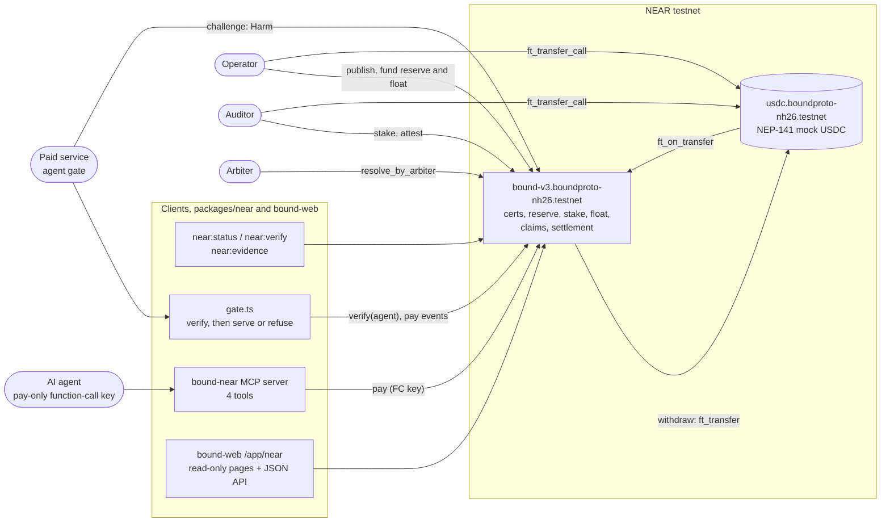
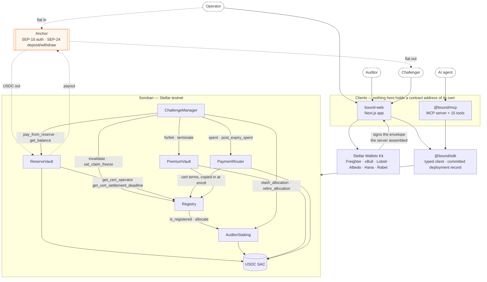
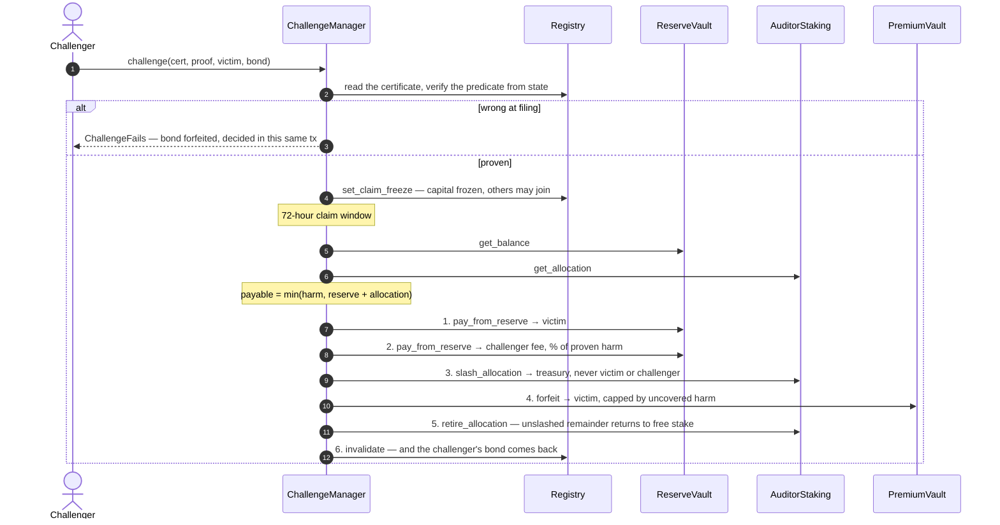

# Bound Protocol

> **A surety bond for AI agents, on-chain.**

## NEAR HACKATHON submission (start here)

Built at NEAR HACKATHON. Branch `near-hackathon` adds **Bound on NEAR**: the
protocol as one near-sdk contract on NEAR testnet, a TypeScript client, an
agent gate, an MCP server for agents, and read-only web pages. Only the NEAR
integration is submitted and judged. Everything else in this repo is prior
work from earlier Stellar hackathons (see "Prior work and what is new").

**What it is.** A counterparty calls `verify(agent)` before dealing with an AI
agent's NEAR account and sees what stands behind it: a USDC reserve the
operator locked, an auditor's slashable stake locked to that one certificate,
and a spend meter. The agent's only key is a function-call key that can call
nothing but the contract's `pay`, and the account holds no contract code (local or global), so
NEAR itself refuses any other spend. If the agent causes harm, a claim window
opens and one atomic settlement pays the victim from the reserve first and
then from the auditor's slash.

**The problem.** Agents now hold keys and pay for things. A service that
serves an agent, or extends it credit, cannot know its worst case:
reputation says nothing about a fresh account, and a spending limit caps what
the agent can send, not what it can owe or break. Bound turns that into one
number a service can read: `coverage = reserve_locked + allocation`.

**Why NEAR.**

- Function-call access keys are a protocol feature. The agent's key is
  limited to `receiver = bound-v3`, `methods = ["pay"]`, no deposit. The
  limit is enforced by NEAR before execution, not by our contract or an SDK,
  and anyone can check it with `view_access_key_list` plus
  `view_account.code_hash`.
- Named accounts: `verify("bound-agent2-mwfnc6q8.testnet")` is readable by a
  human and an agent alike.
- NEP-141 `ft_transfer_call` gives custody in one transaction (stake,
  deposit, fund reserve), and NEP-297 events are the payment receipts the
  agent gate checks.

**Tracks:** `security` (primary), `agents`, `open`.

| What                        | Where                                                                                                                                                                                                                                              |
| --------------------------- | -------------------------------------------------------------------------------------------------------------------------------------------------------------------------------------------------------------------------------------------------- |
| Full NEAR README            | [`near/README.md`](./near/README.md): try it, demo act by act                                                                                                                                                                                      |
| Design, trust model, limits | [`near/DESIGN.md`](./near/DESIGN.md)                                                                                                                                                                                                               |
| Contract (testnet)          | [`bound-v3.boundproto-nh26.testnet`](https://testnet.nearblocks.io/address/bound-v3.boundproto-nh26.testnet), code hash `A3yf1yzihbUdZAaHn92aAm5dBAdFCq1QCwhBJixD2B4H`                                                                             |
| Token (testnet)             | [`usdc.boundproto-nh26.testnet`](https://testnet.nearblocks.io/address/usdc.boundproto-nh26.testnet): mock USDC, open mint, play money                                                                                                             |
| Recorded demo run           | [`near/evidence/near-demo-mwfnc6q8.txt`](./near/evidence/near-demo-mwfnc6q8.txt): 41 steps, 37 txs, 36 assertions, 0 failed                                                                                                                        |
| Recorded MCP agent run      | [`near/evidence/mcp-agent-mwfnc6q8.txt`](./near/evidence/mcp-agent-mwfnc6q8.txt)                                                                                                                                                                   |
| Live demo (web)             | [near.boundprotocol.dev/app/near](https://near.boundprotocol.dev/app/near) (bound-web branch `near-hackathon`, read-only, no wallet). Run it locally with `near/README.md` step 6. The demo video is linked from the X post.                       |
| Code written in the window  | bound: [`pre-hackathon...near-hackathon`](https://github.com/iamnotdou/bound/compare/pre-hackathon...near-hackathon), bound-web: [`pre-hackathon...near-hackathon`](https://github.com/iamnotdou/bound-web/compare/pre-hackathon...near-hackathon) |

### On-chain proof (NEAR testnet, run mwfnc6q8 on bound-v3)

Every hash below is re-checked against RPC by `pnpm --silent near:evidence`.
NearBlocks shows a bot wall to `curl`; open the links in a browser.

| Step                                                                  | Result                                               | Tx                                                                                                                                                                                             |
| --------------------------------------------------------------------- | ---------------------------------------------------- | ---------------------------------------------------------------------------------------------------------------------------------------------------------------------------------------------- |
| Deploy bound-v3 (create + deploy + `new`)                             | succeeded                                            | [7tM75SZT...](https://testnet.nearblocks.io/txns/7tM75SZT6U15Brz9pRC5EGSdmqkSR4bEUyFDqApSGGGP)                                                                                                 |
| Operator publishes cert 0 (bound 150, reserve 100, float cap 20)      | succeeded                                            | [Ec2fCtsm...](https://testnet.nearblocks.io/txns/Ec2fCtsmyuQMpu88u4v1TME3JTSkjQrcqpQhnSaWY1AN)                                                                                                 |
| Operator funds reserve 100                                            | succeeded                                            | [9AuoWUhP...](https://testnet.nearblocks.io/txns/9AuoWUhPFQ2LeuRw1rEchZSGQJKbMyu9tEctoTuBC2QK)                                                                                                 |
| Auditor attests, locking 200 of its stake                             | succeeded                                            | [8B53DHbh...](https://testnet.nearblocks.io/txns/8B53DHbhg7j54t82GDkHxsUFyB6gmLyWmw4tpDnGivWD)                                                                                                 |
| Agent adds a function-call key (bound-v3, `pay`)                      | succeeded                                            | [D7EQYAiK...](https://testnet.nearblocks.io/txns/D7EQYAiKt7KszcH5Yh1k2CV198mZ9DXSovphVK8Vr483)                                                                                                 |
| Agent deletes its full-access key                                     | succeeded                                            | [3xo9H1Jb...](https://testnet.nearblocks.io/txns/3xo9H1JbMMTsZMowwwDCLhXuJ7VwzSdSpEbXQrkHcTkr)                                                                                                 |
| Agent pays the service 5 through `pay`                                | succeeded                                            | [CfV9XQWj...](https://testnet.nearblocks.io/txns/CfV9XQWjur7KrvwW11k9wf7dVis9SehEGgJN7DKkcK8k)                                                                                                 |
| Scripted attack: pay 50 over a float of 15                            | refused on chain, `FloatExceeded` (expected)         | [DUe2fDHN...](https://testnet.nearblocks.io/txns/DUe2fDHN9aDUaHH4s8dSpvtJtaXVjmTEZsMKxuapfZro)                                                                                                 |
| Scripted attack: pay 10 to an attacker                                | refused on chain, `RecipientNotAllowed` (expected)   | [CuXuHhfG...](https://testnet.nearblocks.io/txns/CuXuHhfG58T7C3fFGxcuaBN5dEpWmdKMQXBB9MN9USF5)                                                                                                 |
| Same key: `ft_transfer`, `mint`, `withdraw`, send NEAR                | refused by NEAR before execution (no tx exists)      | errors recorded in the evidence file                                                                                                                                                           |
| Operator halts; agent pays 1                                          | refused, `CertHalted` (expected)                     | [ceRd2LS6...](https://testnet.nearblocks.io/txns/ceRd2LS6jCxNkzznTwgeU4Vn8wDemv7oUcf58u6HcEd)                                                                                                  |
| False `BoundExceeded` claim (spent 5 <= bound 150)                    | rejected in the same tx, bond to treasury            | [FBSjeUNd...](https://testnet.nearblocks.io/txns/FBSjeUNdQZ8w4ekmPo4Z9ds5bTbJmPtzGfX1bhvtHj6j)                                                                                                 |
| Service files Harm 120 citing its unpaid invoice                      | succeeded                                            | [FkAyuN4q...](https://testnet.nearblocks.io/txns/FkAyuN4qvegyRbEi1PsPvQ1pyeRmZdjqf7jgX7c5r5RX)                                                                                                 |
| Arbiter upholds harm 120                                              | succeeded                                            | [4HyE7LAs...](https://testnet.nearblocks.io/txns/4HyE7LAsygqR7MsJgaoqwg6cFeNwAsCPNSSLppbdkHyY)                                                                                                 |
| Agent pays 1 while the claim window is open                           | refused, `CertFrozen` (expected)                     | [6ABTGrX7...](https://testnet.nearblocks.io/txns/6ABTGrX7KNTQXXTVNp76vjkwF1Cpj4RwJ32XqKrz8xWE)                                                                                                 |
| Anyone calls `close_window`: victim gets 120 (100 reserve + 20 slash) | succeeded                                            | [GT4SuspD...](https://testnet.nearblocks.io/txns/GT4SuspDnRd4m2N6XDy35h9P6fqKwYZ1SWMvQ1oStwDu)                                                                                                 |
| Service withdraws 135 (5 prepaid + 120 + 10 bond back)                | succeeded                                            | [AReDbvB1...](https://testnet.nearblocks.io/txns/AReDbvB1croL5oq8QwBtFpCuF69oeshxBssBgNaTWrfD)                                                                                                 |
| Cert 1 published for agent2, left Verified until 2026-11-30           | succeeded                                            | [FGuXn4DM...](https://testnet.nearblocks.io/txns/FGuXn4DModurmVqPyEQspjtniTg7qx5BYVMHEw4Ey8RC)                                                                                                 |
| MCP: agent2 pays 1 through `near_pay`                                 | succeeded                                            | [DXQefHoU...](https://testnet.nearblocks.io/txns/DXQefHoUNs79KRWk4cPXSJwcvYRG9gqNBze1EymQnAon)                                                                                                 |
| MCP: agent2 pays 500 (over the float), then pays the treasury         | refused, `FloatExceeded`, then `RecipientNotAllowed` | [F4rFLPHu...](https://testnet.nearblocks.io/txns/F4rFLPHuvTGZRSw2GfP1vfUbscBGPyVxRnngYUk5w3g7), [EJHDkWse...](https://testnet.nearblocks.io/txns/EJHDkWsesjnz37CPvdA7MXGh3yqTGWeQ9dozRK7hrX4c) |

The full list (every tx of every run, the superseded bound-v1 and bound-v2 included) is in
[`near/deployments/testnet.json`](./near/deployments/testnet.json) and
`near/evidence/`.

### Quickstart (from a clean clone, no NEAR account needed)

Prerequisites: Rust via rustup (the `near/` toolchain pin 1.95.0 installs
itself), cargo-near 0.23, node 22, pnpm 10. Run from the repo root.

1. `git clone -b near-hackathon https://github.com/iamnotdou/bound && cd bound`
2. `pnpm install --frozen-lockfile`: exit 0.
3. `cd near && cargo test && cd ..`: see `132 passed` (unit), `2 passed`
   (near-sandbox), `4 passed` (mock token). About 4 minutes cold; the first
   run downloads the sandbox binary.
4. `near/scripts/verify.sh`: builds both wasm, checks their sha256 equals the
   deployed code hash, runs fmt, clippy, all tests, typecheck and vitest, and
   re-checks every recorded testnet transaction. Ends with
   `== all checks passed`, exit 0 (about 3 minutes).
5. `pnpm --silent near:status`: the on-chain `code_hash` of bound-v3 equals
   the recorded one, plus the live config.
6. `pnpm --silent near:verify bound-agent2-mwfnc6q8.testnet`: cert 1
   Verified, coverage 130, `confinement: confined (1 key(s), no contract code, no global contract)`,
   `decision: deal`, exit 0.
7. `pnpm --silent near:verify bound-agent-mwfnc6q8.testnet`: cert 0 Invalid
   after settlement (payable 120, reserve draw 100, slash 20),
   `decision: refuse`, exit 2 on purpose.
8. `pnpm --silent near:evidence`: `all 172 recorded transactions match the chain`.
9. `pnpm --silent near:mcp-smoke`: `bound-near MCP smoke passed`.
10. Optional, writes to testnet: `pnpm near:demo --fresh` deploys a private
    copy and replays acts 1-8 (about 5 minutes, needs a funded testnet
    account when the faucet rate-limits; see `near/README.md` step 4).
11. Web pages: in bound-web on branch `near-hackathon`,
    `pnpm install --frozen-lockfile && pnpm build && pnpm start`, open
    `http://localhost:3000/app/near`, or run
    `pnpm check:near http://localhost:3000` (`12/12 checks passed`).

MCP client config (stdio, stdout is pure JSON-RPC):
`{"command": "pnpm", "args": ["--silent", "--dir", "<repo>", "near:mcp"]}`.
Tools: `near_verify_agent`, `near_get_certificate`, `near_check_agent_keys`,
and `near_pay` (enabled only with an agent id and its pay-only key in the
environment).

### Architecture



One contract holds all state, so settlement (reserve draw, slash, refunds,
invalidation) is one synchronous transaction with no cross-contract rollback
cases. Token movements are the only async calls (`ft_on_transfer` in,
`ft_transfer` with a callback that re-credits on failure out).

### What was built during the hackathon

Compare links (the window starts 2026-10-19; `pre-hackathon` is the last
commit before it, from 2026-09-20):

- bound: [`pre-hackathon...near-hackathon`](https://github.com/iamnotdou/bound/compare/pre-hackathon...near-hackathon)
  (also frozen as tag `hackathon-submission`)
- bound-web: [`pre-hackathon...near-hackathon`](https://github.com/iamnotdou/bound-web/compare/pre-hackathon...near-hackathon)

New in the window:

- `near/contracts/bound`: the protocol as one near-sdk 5.30.1 contract
  (certificates, reserve, auditor stake and allocation, float and `pay`
  meter, allowlist, halt, claims, claim window, settlement waterfall,
  storage management, NEP-297 events), with 132 unit tests and 2
  near-sandbox lifecycle tests.
- `near/contracts/mock-usdc`: NEP-141/145/148 token with open mint.
- `packages/near`: near-api-js client, deploy, the 8-act testnet demo, the
  agent gate, the `bound-near` MCP server, status, verify, evidence checks.
  The keyless part (read client, `bound-near verify|cert|mcp` CLI, MCP
  server, bundled testnet deployment) is packaged for npm as `@bound/near`;
  see `packages/near/README.md`. Run it with
  `npx @bound/near verify <agent>` or as an MCP server with
  `npx -y @bound/near mcp`.
- `near/deployments/testnet.json` and `near/evidence/`: the deployment
  record and every demo transaction.
- bound-web: `/app/near`, `/app/near/cert/<id>`, `/app/near/run/<runId>`,
  `GET /api/near/verify/<agent>`, `pnpm check:near`.

Outside `near/` and `packages/near/` the bound diff touches only the root
`package.json` (`near:*` scripts), `Cargo.toml` (`exclude = ["near"]`),
`.prettierignore`, `pnpm-lock.yaml` and this section of the README.

Prior work, not judged: the Soroban contracts in `contracts/`,
`packages/sdk`, `packages/mcp`, `bindings/`, `scripts/` and `docs/`, built
for the Build On Stellar Hackathon (IBW 2026 Istanbul) and the Rise In x
Stellar Pro Hackathon 2026. The NEAR contract is a re-implementation of that
design for NEAR, not a compiled copy; the deviations are in
`near/DESIGN.md`.

### Libraries used

- Rust: near-sdk 5.30.1, near-contract-standards 5.30.1, near-sandbox 0.4,
  near-api 0.8, cargo-near-build 0.11, tokio, testresult, serde_json.
- TypeScript: near-api-js 7.5.3, @modelcontextprotocol/sdk 1.29, zod 3, tsx,
  vitest, typescript, @types/node.
- Web (bound-web, already in the app): Next.js, React, vitest. No new
  dependencies.
- Tooling: cargo-near 0.23.0, near-cli-rs 0.31.1. RPC: FastNEAR testnet and
  archival nodes.

### AI tools used

Claude Code (Anthropic) wrote the NEAR contracts, tests, TypeScript package,
scripts, web pages and these docs on this branch, under the author's
direction. A pre-submission review, also run with Claude Code, found the
bound-v1 issues that bound-v2 fixes (listed in `near/DESIGN.md` section 9)
and the issues that bound-v3 fixes (section 10).

### Found by review, fixed before submission

A separate pre-submission security review of the code and the deployed
contract (run as its own pass, see "AI tools used") found real bugs. Each fix
has a regression test that failed on the reviewed code. Details:
`near/DESIGN.md` sections 9 and 10.

- bound-v1: a certificate id cast from u64 to u32 could alias another
  certificate and let collateral escape during an open claim window; the
  confinement check ignored contract code on the agent account. Fixed in
  bound-v2.
- bound-v2, C1: the operator could end its liability early (loop the float
  through a sybil until `spent > bound`, file `BoundExceeded`, and the
  settlement released the reserve and the auditor's allocation at once).
  Now a settled cert stays open to Harm claims until the settlement
  deadline and its collateral stays locked until then.
- bound-v2, C2: 16 cheap claims just before the deadline could fill the
  claim window and lock the real victim out. Now a rejected claim frees its
  slot at once, and a window opened before the deadline still accepts claims
  until it closes.
- C3 (clients): an account using a NEAR global contract reported the empty
  code hash and passed the confinement check. The client, the MCP tool and
  the web pages now also require the `global_contract_*` fields to be null.
- Six minor contract issues (harm overflow, deadline off-by-one, conflicted
  victim, excess deposit refund, halted and superseded views) were fixed in
  the same pass, and two follow-up review rounds added a cap on the
  post-deadline window extension and an overflow-free settlement
  multiplication. The fixed code is deployed as bound-v3; bound-v1 and
  bound-v2 stay on chain with their runs, labeled superseded.

What is not fixed is listed below: the trusted roles remain.

### Honest limitations

- Trusted roles: on testnet the author holds the arbiter (decides Harm
  claims and could uphold a fake one), the treasury and the contract's
  full-access key (the code could be replaced; check `code_hash` against
  the recorded build). Roadmap: a per-certificate or Sputnik DAO arbiter, a
  DAO treasury, and deleting the contract key.
- Testnet only, mock USDC with open mint, shortened timers (90 s claim
  window). No mainnet deployment exists.
- `bound` is a spend meter, not a guarantee. What a counterparty can rely on
  is `coverage = reserve_locked + allocation`. Gates of different services
  can extend credit against the same coverage, so credit is
  oversubscribable across services.
- `verify()` alone does not prove confinement: the contract cannot read the
  agent's keys. A counterparty must also check the access keys and the
  account code hash (`near:verify`, the MCP tool and the web page do both).
- No language model runs in the demo. Act 4 is a scripted attack: the exact
  calls a hijacked agent could make with its key.
- Harm is decided off chain by the arbiter; only `BoundExceeded` is a
  trustless predicate. `InsufficientReserve` is unreachable on NEAR and kept
  for ABI parity.
- `bound-v1` (first deployment) had a certificate-id aliasing bug and is
  superseded; `bound-v2` ran the code from before the second review's
  fixes (`near/DESIGN.md` section 10) and is superseded by `bound-v3`. Their
  runs stay in `near/evidence/` and are labeled.
- The hosted web demo (https://near.boundprotocol.dev/app/near) is a frozen deploy of the `hackathon-submission` commit; it reads live testnet state.
- Old transactions are read from an archival RPC node; a rate-limited IP can
  see "could not be fetched just now" for them, which is labeled as no
  answer, not as a mismatch.

---

## The Stellar version (prior work, not part of the NEAR submission)

> Originally built for the Build On Stellar Hackathon (IBW 2026 Istanbul),
> then submitted to the Rise In x Stellar Pro Hackathon 2026, Scale Track.

Know your worst case _before_ you transact. AI agents now hold wallets and move money
autonomously, but reputation can't tell you your maximum downside — models change
silently and a fresh identity is free. Bound Protocol replaces the unanswerable
_"can I trust this agent?"_ with a number you can look up:

> **"Your worst-case loss is bounded at $X, it's pre-funded, and an independent auditor
> staked their own money that this is true."**

---

|                   |                                                                                                                                                                 |
| ----------------- | --------------------------------------------------------------------------------------------------------------------------------------------------------------- |
| **Live demo**     | [www.boundprotocol.dev/app](https://www.boundprotocol.dev/app) (Stellar version) — browse bonded agents, publish and fund a certificate, attest one             |
| **Documentation** | [docs.boundprotocol.dev](https://docs.boundprotocol.dev)                                                                                                        |
| **SDK**           | [`@bound/sdk`](https://www.npmjs.com/package/@bound/sdk) — typed client for the whole lifecycle                                                                 |
| **MCP connector** | [`@bound/mcp`](https://www.npmjs.com/package/@bound/mcp) — 15 tools for any MCP-capable agent                                                                   |
| **Quickstart**    | [`docs/QUICKSTART.md`](./docs/QUICKSTART.md) — reproducible from a clean clone                                                                                  |
| **What is built** | [`docs/DELIVERABLES.md`](./docs/DELIVERABLES.md) — per-requirement audit, checked against source                                                                |
| **Trust model**   | [`docs/THREAT-MODEL.md`](./docs/THREAT-MODEL.md) and the [disclosed defects](https://docs.boundprotocol.dev/docs/trust-model#defects-in-the-deployed-contracts) |

### Repositories

|                                                         |                                                         |
| ------------------------------------------------------- | ------------------------------------------------------- |
| [`bound`](https://github.com/iamnotdou/bound)           | this repo — contracts, SDK, MCP connector, demo scripts |
| [`bound-web`](https://github.com/iamnotdou/bound-web)   | the marketing site and the app at `boundprotocol.dev`   |
| [`bound-docs`](https://github.com/iamnotdou/bound-docs) | the documentation site at `docs.boundprotocol.dev`      |

Testnet only. Amounts are testnet USDC and no mainnet deployment exists.

## How it works

1. **Lock the reserve.** The operator locks real USDC in a vault. It's the pre-funded
   payout, and it can't be withdrawn until the certificate expires.
2. **An auditor vouches — with their own money.** The instant they attest, their stake
   locks to the certificate. If the vouch is false, they lose it.
3. **Read before you transact.** Any counterparty calls `verify(agent)` and sees the
   bound, the locked reserve, the auditor's stake, and the status.
4. **Anyone can catch a lie — and gets paid.** If the reserve is short, the contract
   proves it itself and slashes the auditor in one transaction: 80% to the victim,
   20% to whoever caught it. No oracle. No judge. Just arithmetic.

The honest edge: a **short reserve** is provable on-chain with zero trusted parties.
Proving _who was harmed_ or _how much an agent spent_ can't be — those name a victim
or fall back to a named arbiter. The certificate tells you which is which.

Contributing, or pointing an agent at this repo? Start with
[`AGENTS.md`](./AGENTS.md) — commands, prohibitions, and the definition of done.

Full documentation lives in [`docs/`](./docs):

| Document                                   | What it covers                                      |
| ------------------------------------------ | --------------------------------------------------- |
| [`docs/WRITEUP.md`](./docs/WRITEUP.md)     | The academic framing, developer docs, and narrative |
| [`docs/PROJECT.md`](./docs/PROJECT.md)     | The build plan, trust model, and known limitations  |
| [`docs/RESOURCES.md`](./docs/RESOURCES.md) | Reference material and external links               |

---

## Architecture

Seven Soroban (Rust) contracts on Stellar Testnet, a published TypeScript SDK, a
published MCP connector, and a Next.js app in its own repo. All value moves in
USDC — the testnet Circle SAC — and no contract holds a key: every write is
authorised by the actor it belongs to.

```
contracts/
├── registry/            # Certificates: publish, attest, verify, invalidate, freeze
├── reserve-vault/       # The operator's locked USDC, walled off per certificate
├── auditor-staking/     # The auditor's stake, allocated per certificate, slashable
├── challenge-manager/   # Four proof types, the claim window, and settlement
├── payment-router/      # SEP-41 wrapped USDC that meters spend per certificate
├── premium-vault/       # Coverage premiums, accruing to the auditor as yield
├── fee-escrow/          # Deployed but unused — superseded by premium-vault
├── spend-probe/         # Never deployed: the executable proof that spend ≠ loss
└── integration-tests/   # Offline cross-contract harness

bindings/                # Generated TypeScript clients — never hand-edited
packages/sdk/            # @bound/sdk — the publishable typed client
packages/mcp/            # @bound/mcp — the agent tools, packaged as an MCP server
scripts/                 # setup, deploy, demo, evidence, anchor, and the smoke suites
deployments/             # testnet.json — the single source of truth for addresses
```

### System



The dotted edges are the fiat rail: a reserve funded from a SEP-24 deposit, and a
proven claim paid out through a SEP-24 withdrawal. That is the boundary the
protocol is only useful across — a surety bond whose collateral cannot be funded
from, or redeemed to, money people actually spend is not a bond.

### Settlement

The part worth reading closely. One rule, applied identically to every proof
type, with the pots drawn in a fixed order:



Every line closes a specific attack; the reasons are attached to them in
[`contracts/challenge-manager/src/lib.rs`](./contracts/challenge-manager/src/lib.rs).
The one that matters most: **the auditor's slash goes to the treasury, never to
the victim or the challenger.** A colluding operator who files a challenge
against their own certificate must not be able to collect the auditor's stake.

### The claim the protocol refuses to make

`PaymentRouter::spent(cert_id)` is **gross routed flow, not loss**. The
arithmetic cannot be forged, so `spent > bound` is a sound predicate — and a
worthless settlement rule, because one dollar shuttled between two addresses the
same operator controls drives the counter past any bound for the price of gas.
[`contracts/spend-probe`](./contracts/spend-probe) is the executable proof and is
kept in the workspace for that reason. Anything that pays out is sized by harm
proven to a party outside the operator's control, and capped by the collateral
actually behind the certificate.

## Deployed contracts (Stellar Testnet)

Generated from [`deployments/testnet.json`](./deployments/testnet.json), which the
deploy script owns and `@bound/sdk/deployments` publishes. `test/docs-integrity.test.ts`
fails if this table and that record ever disagree, so an address here is an address
you can paste into an explorer.

| Contract         | Address                                                    | What it does                                                                   |
| ---------------- | ---------------------------------------------------------- | ------------------------------------------------------------------------------ |
| Registry         | `CCJTY2VYHQZ7OQE6NX7QFL7JL766YMTNKGHZXGAPTPKV5IUS2AK5UREF` | Certificates. `publish` → `attest` → `verify`.                                 |
| ReserveVault     | `CD6VK2YUUZO5L5R76DNT3NQNWR2UCALPQ3T6STWAQSEY7Q6I5P4LAFC3` | The operator's locked USDC, walled off per certificate.                        |
| AuditorStaking   | `CBPUCSASKMQKRWJ7WUTQ6KUPX66QUBV2E6V4CQ46BI4ZLJSW6AFPR6RB` | The auditor's own stake, allocated per certificate and slashable.              |
| ChallengeManager | `CAYEGPIHNDIEONWNKRF2UPTO32SXGFTLBQ2K4RPN2LCIGOOZYLYYYIHY` | Four proofs, a 72-hour claim window, pro-rata settlement.                      |
| PaymentRouter    | `CA5OPBLVGNPAFNFHY3ATNZXJ72L3K4EG4RIQYOWOKESAN7C75DDMMCMJ` | SEP-41 wrapped USDC that meters an enrolled agent's spend.                     |
| PremiumVault     | `CA5JT2IBPY7X4QZS65XY6YW2BXDUEFPZHXTNG2OCPCJTOM4DWEWEOHAF` | Coverage priced bound × duration, accruing to the auditor as yield.            |
| FeeEscrow        | `CAM3D5PTXQ4MEY45SGNUZZGNN2D6JXHSCFR3IM6S46KCPWERWJGDFXNI` | Deployed but unused — superseded by PremiumVault, kept rather than redeployed. |
| USDC             | `CDIQ4564SFRCLBP2UL4Z5IBGEBDF2J5ISQVCTHN3F5SNVDXGSB5YEAMM` | The testnet Circle Stellar Asset Contract. Every amount moves in this token.   |

Deployed 2026-08-21 from commit [`82e34af8b9e8`](https://github.com/iamnotdou/bound/commit/82e34af8b9e8b4456623b46bda4b32016f8abc4f).
Read-only simulations use the funded source account `GDOUNKJLAMAPLK7IZ2MGBE3S4RHF4SSQYPDRCGK2VNSP6IHFR5OQ7HGF`.

---

## The anchor deployment (Stellar Testnet)

The same seven contracts, deployed a second time and denominated in **money we
do not issue**: the USDC of the SEP-24 reference anchor, which is also the asset
the Turkish lira ramp delivers.

It exists because of a gap the first deployment cannot close. There, the
operator issues the token its own reserves are denominated in — so a reserve is
funded by the operator printing what it promises, and the guarantee is circular.
Here the operator cannot mint at any price. Every stroop in a reserve got there
by crossing a fiat boundary, which is the only version of a surety bond that
means anything.

Generated from [`deployments/testnet-anchor.json`](./deployments/testnet-anchor.json).
Select it with `STELLAR_NETWORK=testnet-anchor`; unset still means the deployment
above, whose addresses have not moved.

| Contract         | Address                                                    | What it does                                                             |
| ---------------- | ---------------------------------------------------------- | ------------------------------------------------------------------------ |
| Registry         | `CD7OFMJ6PWVT4RT25N2PUFWTGCP3MUXC6OUON4KOSS5RU4YUORRADM5J` | Certificates. `publish` → `attest` → `verify`.                           |
| ReserveVault     | `CBXRDBWMDES6QQYQCFG3F2DCHBD32KD3E6FL7OUG4LZ7ASAAPZE2OSPP` | The operator's locked USDC, walled off per certificate.                  |
| AuditorStaking   | `CAG32DHMFD6NJVIZQDO3NWPEPPKMWY2OBICH2FONAR26A74RSW7NEVRX` | The auditor's own stake, allocated per certificate and slashable.        |
| ChallengeManager | `CARLTFSSZBJ4OCOAQQZAWJW3TD4B4XYZG2SY4CPJN46QWN7QCIKUNPOC` | Four proofs, a 72-hour claim window, pro-rata settlement.                |
| PaymentRouter    | `CCSEEDBRDXEN5HMVJOL7AMMGXCJGG4HSFZ4LHOT4EFRZIHR4QI5UXAHG` | SEP-41 wrapped USDC that meters an enrolled agent's spend.               |
| PremiumVault     | `CCCK5M7DVY3IT6L2TYA5N2CSFHCNQM4HXX6CM3ZHTOXT5LI44YN34YGL` | Coverage priced bound × duration, accruing to the auditor as yield.      |
| FeeEscrow        | `CB2QPKDOAL657X46KMELTWWK36JWFI7GYAXU5RKMLMBA7YP4IGOK2KZX` | Deployed and initialized, unused — superseded by PremiumVault.           |
| USDC             | `CBIELTK6YBZJU5UP2WWQEUCYKLPU6AUNZ2BQ4WWFEIE3USCIHMXQDAMA` | **The anchor's own asset**, not ours: the SAC wrapping `USDC:GBBD47IF…`. |

Deployed 2026-09-20 from commit [`467a9f386600`](https://github.com/iamnotdou/bound/commit/467a9f386600d2ca09cfebd04689e8864db43181).

### How its money got in

Both rails are real, and neither is a mock of the other half:

| Rail   | Anchor                   | What happened                                                                                                                                                                                                                                                                                                                                                                   |
| ------ | ------------------------ | ------------------------------------------------------------------------------------------------------------------------------------------------------------------------------------------------------------------------------------------------------------------------------------------------------------------------------------------------------------------------------- |
| SEP-24 | `testanchor.stellar.org` | 3.6 USD in → **3.3 USDC** out, completed, Stellar tx [`3f0fbed3…c89e9d`](https://stellar.expert/explorer/testnet/tx/3f0fbed34fe86e4ae5a40f79bc1651426e97cda76b40be3348f86e99d6c89e9d). That anchor's distribution account held 3.3766368 USDC when we got there, so this is not a chosen amount — it is what was left.                                                          |
| SEP-6  | `tr-mock-anchor.fly.dev` | 4 900 TRY in → 24.38 TRY spread → **99.94 USDC** quoted at the Reflector USD/TRY rate. The anchor accepted the transfer and stalled before paying out: its last outgoing payment was `2026-09-19T23:10:02Z` and ours sits at `pending_anchor`. The integration is proven up to the anchor's own last hop; that hop has not happened, and this table is not going to say it did. |

The scale follows from the first row. The SEP-24 anchor caps a transfer at 10
units and had 3.3 to give, so the anchor deployment runs at **1/2000 scale** —
`BOUND_AMOUNT_SCALE=0.0005`, every ratio the contracts assert on preserved, every
figure divided by the same number. A $500 bond reads as $0.25 and is exactly as
provable.

### The lifecycle, on that money

Certificate #1 on the anchor registry: published, reserve funded in full,
attested by a staked auditor, agent enrolled in the router, three routed
payments totalling **$0.30 against a $0.25 bound** — and `BoundExceeded` admitted
from that on-chain state alone. A false claim filed alongside it was rejected and
settled inside its own filing transaction, the challenger's bond forfeit, with no
arbiter involved.

```bash
STELLAR_NETWORK=testnet-anchor BOUND_ENV_FILE=.env.anchor \
  BOUND_AMOUNT_SCALE=0.0005 pnpm run demo
```

---

## Stellar Skills used

The [official skill files](https://skills.stellar.org/) that bear on the code in
this repo, cited by path as the submission requires. Each line names the part of
the codebase it applies to, so a reader can check the claim rather than take it.

| Skill file                  | Where it applies                                                                                                                                                                                                                                                                                                                                                                                                                                                                                      |
| --------------------------- | ----------------------------------------------------------------------------------------------------------------------------------------------------------------------------------------------------------------------------------------------------------------------------------------------------------------------------------------------------------------------------------------------------------------------------------------------------------------------------------------------------- |
| `skills/anchors/SKILL.md`   | [`scripts/anchor-deposit.ts`](./scripts/anchor-deposit.ts), [`scripts/anchor-status.ts`](./scripts/anchor-status.ts), [`scripts/anchor-trustlines.ts`](./scripts/anchor-trustlines.ts) — SEP-10 challenge/sign/JWT, the SEP-24 interactive deposit, and the classic trustline the anchor's asset needs before it can land. Also `bound-web/lib/anchor.ts`, where the same skill's SEP-6 half is implemented: a deposit against an anchor that hosts no form, which is what the Turkish lira ramps are |
| `skills/standards/SKILL.md` | The SEP choices themselves: SEP-41 for [`contracts/payment-router`](./contracts/payment-router), SEP-10 for authentication, **SEP-24 or SEP-6 chosen from the anchor's own `stellar.toml`** rather than compiled in, SEP-38 for the TRY/USD quote the lira rail prices against, and why `transfer` may make no sub-invocation                                                                                                                                                                         |

`skills/integration-finder/SKILL.md` is cited for what it settled rather than for
code it produced: the TRY↔USDC crossing belongs at the anchor, over SEP-6 and
SEP-38, not at a DEX. A swap would have priced lira against a pool; the ramp
prices it against a bank, which is the thing a bond has to pay out into.
`skills/soroswap/SKILL.md` is therefore **not** cited — that integration was
considered and deliberately not built.

## Key design decisions and trade-offs

Each of these cost something. The cost is stated, because a decision presented
without its price is a decision nobody can evaluate.

**A slash pays the treasury, never the victim or the challenger.**
`settle_fraud` draws the victim's compensation and the challenger's fee
(`CHALLENGER_FEE_BPS`, 10% of proven harm) from the _operator's own reserve_, and
sends the auditor's slashed allocation somewhere neither party can reach.
Otherwise an operator files a challenge against their own certificate, names an
address they control as the victim, and collects the auditor's stake for the
price of a bond. **The cost:** a victim whose harm exceeds the reserve is not
made whole out of the auditor's capital, even though that capital was slashed.
Bound bounds the loss; it does not always cover it.

**The spend counter is evidence, not a payout trigger.**
`PaymentRouter::spent(cert_id)` cannot be forged, so `spent > bound` is a sound
predicate — and a worthless settlement rule, because a single dollar shuttled
between two addresses one operator controls drives the counter past any bound for
the price of gas. `contracts/spend-probe` is the executable proof and is kept in
the workspace for no other reason. **The cost:** `BoundExceeded` settles in
hygiene mode only — it can kill a certificate, not pay out on one.

**The router custodies USDC instead of wrapping the SAC.**
x402 facilitator settlement requires that paying for a resource is exactly one
`transfer` call emitting exactly one event with no sub-invocations. A router that
called through to the underlying SAC would emit two and break settlement, so it
holds the asset and moves internal balances. **The cost:** a custodial contract
is a larger thing to trust than a passthrough. Mitigated, not eliminated, by a
per-certificate `float_cap` that bounds what a stolen agent key can reach, and by
the operator's `halt` — and `transfer` may therefore make no cross-contract call
at all, so everything the hot path needs is copied into router storage at
`enroll`.

**Capital unlocks at the settlement deadline, not at expiry.**
A proof about post-expiry conduct only becomes provable _after_ expiry. If the
reserve and the auditor's allocation both unlocked at `expires_at`, such a proof
would settle against an empty pot every single time, so both read
`expires_at + CHALLENGE_WINDOW_SECONDS`. **The cost:** an honest operator's
capital is locked seven days longer than the cover it bought.

**Money is walled off per certificate, not pooled.**
`Balance(cert_id)`, `Allocation(cert_id)`, `Coverage(cert_id)`. Funding one
certificate can never back another, and one bad certificate cannot destroy an
auditor's whole book. **The cost:** capital efficiency. An auditor with ten
certificates cannot let a quiet one's allocation absorb a loud one's claim.

**A claim opens a window rather than paying immediately.**
A proven challenge freezes the certificate for `CLAIM_WINDOW_SECONDS` (72 hours)
and every admitted claim settles together, pro rata. Paying the first filer in
full would make fraud detection a race, and the fastest bot would collect a
collateral pool that other victims also have a claim on. **The cost:** a real victim
waits three days before anything settles.

**A de-minimis floor in basis points, not dollars.**
`ExpiredCertificate` only counts a post-expiry payment as evidence if it is at
least `DE_MINIMIS_FLOOR_BPS` (0.1%) of _that certificate's own_ bound. A flat
floor would be irrelevant at a $1M bound and fatal at a $1k one; anchoring it to
the bound keeps the band of unprovable late payments proportional to the number
the certificate already advertises. **The cost:** small late payments are
genuinely unprovable, and the check reads only the single largest late payment
the router recorded — so a big one inside the grace window masks a smaller,
later one that would have qualified. Upholding fewer real breaches is the safe
direction to be wrong in.

**Two published packages, one definition of the agent tools.**
`packages/mcp/src/tools.ts` is the only place a tool is defined. The `bound-mcp`
executable and any AI-SDK loop are adapters over it, and a consumer imports
`@bound/mcp/tools` — a second entry point carrying the table without the server —
so a Next build never bundles an MCP server. **The cost:** the package cannot
reach into an app for credentials, so it carries its own `accounts.ts` reading
the same five environment variables. Thirty duplicated lines is the price of the
package standing on its own.

**The anchor is configuration, not code.**
`ANCHOR_HOME_DOMAIN` names one and every endpoint is read from its
`stellar.toml` over SEP-1. **The cost:** an extra network round trip before any
SEP-10 or SEP-24 call, cached for sixty seconds — short enough that a rotated
signing key is not trusted for long.

**A failed read is `null`, never `0`.**
"The vault said nothing" and "the vault holds nothing" are different claims about
money, and a UI that renders the first as the second is lying with a plausible
number. Every chain read in the app degrades independently. **The cost:** more
branches in every component — `SpendMeterPanel` and `CoveragePanel` each render
three shapes rather than one shape with blanks.

---

## Technical challenges, and how they were solved

**A well-formed envelope that could never succeed.**
`AssembledTransaction.toXDR()` serialises whatever was assembled, _including an
assembly whose simulation failed_. Verified against the deployed contracts:
attesting an unfunded certificate, attesting as an unregistered auditor, and
funding someone else's reserve all produced perfectly valid XDR. The build
route's comment claimed the simulation caught those. It did not.
`assertSignableXdr` re-simulates the envelope **as assembled** — carrying its
auth entries, which is what makes it fail the cases the first simulation let
through — and separately refuses any envelope needing a signature the connected
wallet does not hold. One extra RPC round trip, in exchange for never asking
somebody to sign a transaction that cannot land.

**A transaction reported as rejected while the money was gone.**
`/api/tx/submit` polls for thirty seconds and then throws, and the UI rendered
that as "the network rejected this" — for transactions that, more often than not,
landed a few seconds later. The hash is a property of the _signed envelope_, so
it is knowable before the network sees it: `bound-web/lib/tx-journal.ts` writes it down
first, and `GET /api/tx/[hash]` asks the chain what actually happened. `NOT_FOUND`
is returned as a status rather than an error, because "never seen" and "failed"
are different facts.

**State archival aborts the transaction instead of returning a default.**
Soroban reclaims instance and persistent entries whose TTL lapses, and _reaching_
one aborts rather than returning zero — so an untouched certificate would stop
being readable, and each contract instance is on the same clock, which would take
a whole contract offline. Every write path now bumps to 120 days with a threshold
at 60, sized against a certificate's own lifetime plus its challenge window, and
the rent is charged to whoever was already paying for that call. The app detects
the residual case by identity (`AssembledTransaction.Errors.ExpiredState`, not a
string match) and tells "never issued" apart from "reclaimed" by reading the
certificate count, which is a separate entry that survives either way.

**Two of the generated bindings are real, unrelated packages on npm.**
The Stellar CLI names them `registry` and `usdc`. Declaring either as a
dependency would fetch a stranger's code, so the SDK imports all of them by
relative path — which means a plain `tsc` would emit those specifiers into
`dist/` and publish a package importing files outside its own tarball. tsup
inlines them instead, and the `external` patterns are regexes rather than strings
so the `@stellar/stellar-sdk/contract` and `/rpc` subpaths are not silently
bundled too.

**Two lockfiles resolved two different major versions.**
The repo once carried both a `package-lock.json` and a `pnpm-lock.yaml`, which
resolved `@stellar/stellar-sdk` 13.3.0 and 16.x respectively — and only one of
those trees produces envelopes a wallet can sign. `bound-web/lib/toolchain.test.ts` now asserts 16.x on both resolution paths, the app's and the SDK's,
because the two resolve it independently.

**Asking a wallet to sign something a third party wrote.**
A SEP-10 challenge arrives from the anchor. Before it reaches a wallet the server
proves it is genuinely a challenge — `readChallengeTx` against the anchor's
declared `SIGNING_KEY`, sequence zero, the home-domain operation, the anchor's own
signature — and refuses a challenge minted for a different account. The subtlety
that cost the most: SEP-10's `web_auth_domain` is the host of `WEB_AUTH_ENDPOINT`,
**not** the home domain. They coincide on the reference anchor, so validating
against the home domain looks correct and silently breaks against any anchor that
serves auth elsewhere.

**An anchor that moves ten dollars at a time.**
The reference anchor caps every transfer at 10 units while the protocol's
defaults are written in hundreds — a $500 minimum auditor stake cannot be reached
through it. `BOUND_AMOUNT_SCALE` divides every USDC figure in the deploy and demo
scripts by one factor, so each ratio the assertions depend on survives:
`DE_MINIMIS_FLOOR_BPS` is in basis points and scales with the bound rather than
against it. Unset, every script behaves exactly as before.

**One helper import that would have shipped the chain SDK to the browser.**
Fixing a gating bug, a pure function was imported from `bound-web/lib/anchor.ts` into a
Client Component — and that module reads `process.env` at module scope and
imports `@stellar/stellar-sdk` for challenge validation. The arithmetic now lives
in `bound-web/lib/anchor-limits.ts`, which imports nothing; `bound-web/lib/anchor.ts` re-exports it so
there is still one definition. Confirmed against the built output rather than
assumed: the chunk carrying the panel is 20 KB and contains no SDK internals.

## Running it

```bash
pnpm install
pnpm verify            # everything CI runs — offline, no secrets, ~6s
```

`pnpm verify` is the definition of done: typecheck, lint, formatting, unit
tests, and the contract fmt/clippy/test suites. It needs no network and no
credentials, so a fresh clone can run it immediately.

The individual pieces, if you want to run one on its own:

```bash
# TypeScript
pnpm test              # unit tests, offline
pnpm typecheck
pnpm lint              # eslint .
pnpm format:check      # prettier

# Contracts
pnpm test:contracts    # cargo test — 21 tests across 5 contracts
pnpm lint:contracts    # cargo clippy -D warnings
pnpm build:contracts   # 5 wasm artifacts
```

Two commands spend testnet funds and mutate on-chain state, so they are kept
out of `verify` and are never automated. Both need `.env.testnet`:

```bash
pnpm test:e2e          # 5 live smoke suites against testnet
pnpm demo              # 8-step: stake → reserve → fee → attest → publish → verify → pay → SLASH
```

Contract addresses and network endpoints are committed in
[`deployments/testnet.json`](./deployments/testnet.json), so `pnpm verify`,
`pnpm build` and `pnpm dev` need no configuration at all.

For the live commands, copy `.env.example` to `.env.testnet` and fill in the
five account secret keys. **Never commit `.env*` files** — they hold secret keys.

---

## License

[MIT](./LICENSE)
